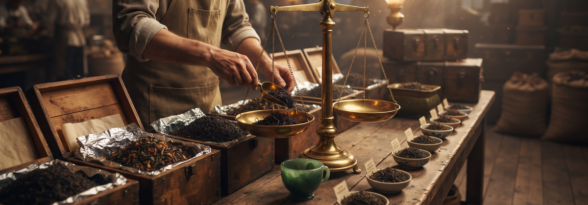
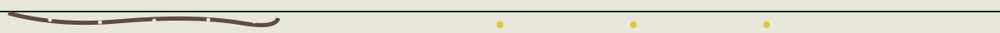

> Sounding line plate: the depth line of the survey, ruled like a tally slate heading. A tiny Zero silhouette sits beside this heading and no other.

# codeintel-Comment-To-Code-Ratio-Analyzer

Calculates the ratio of comments to code lines in a project or file. Identifies areas with poor commenting, which may indicate maintainability or security concerns. In directory mode, a skipped files count is printed whenever any file could not be read, and a directory run that analyzed zero files because every file failed to read exits 1. Single file mode is unchanged: a file that cannot be read exits 1. - Focused on Tools for static code analysis, vulnerability scanning, and code quality assurance

> **Hull plate inset: the tally this tool makes.** Comment lines are counted against code lines, file by file or across a project, and thinly commented stretches are noted as a worry. Nothing in the code is moved by the count.

## Install
`git clone https://github.com/ShadowGuardAI/codeintel-comment-to-code-ratio-analyzer`

> **Hull plate inset: clone line flagged.** The install line above names ShadowGuardAI without its hyphen, not ShadowGuard-AI. It is preserved as printed and flagged here, not quietly corrected.

## Usage
`./codeintel-comment-to-code-ratio-analyzer [params]`

> **Hull plate inset: usage line flagged.** The usage line above is a placeholder. The README names no file or directory argument in its usage or its parameter list, so a reader following the README alone would not know whether to point the tool at one file or at a whole project.

## Parameters
- `-h`: Show help message and exit
- `-e`: No description provided
- `-v`: No description provided

> **Hull plate inset: -e and -v arrive unexplained.** The parameter list above leaves both -e and -v with no description provided, exactly as the README leaves them. Two of the three listed switches arrive unexplained in the tool's own document.

## License
Copyright (c) ShadowGuardAI

> **Hull plate inset: copyright line flagged, and the exit rules.** The closing line above reads Copyright (c) ShadowGuardAI, the same unhyphenated name as the install line, preserved as printed. The exit rules stand in the opening paragraph above: in directory mode a skipped files count is printed whenever any file could not be read, a directory run that analysed zero files because every file failed to read exits 1, and in single file mode a file that cannot be read exits 1.
